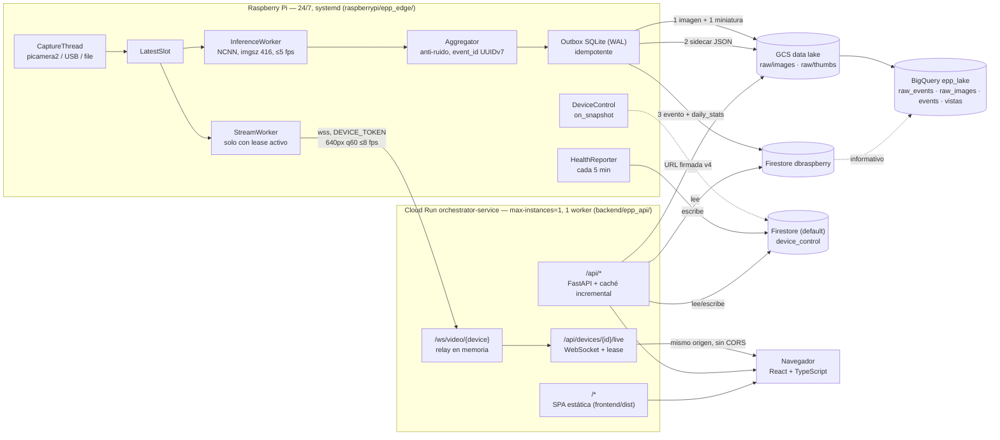

# EPP Monitor

**Para quién es:** cualquiera que llegue al repositorio por primera vez (evaluador de la tesis, quien la retome después, o quien solo quiera correrlo). **Última verificación:** 2026-10-11.

Sistema de detección de Equipo de Protección Personal (EPP) con una cámara en el borde (Raspberry
Pi), subida de eventos y capturas a un data lake en Google Cloud, y un dashboard web con video en
vivo bajo demanda. Proyecto de tesis — repositorio público a propósito; ningún secreto (tokens,
claves de servicio, `.env`) vive en el historial de git.

El sistema fue remediado por completo frente a su primera versión: ver `CHANGELOG.md` para el
resumen de qué cambió y por qué.

## Qué es

- Una Raspberry Pi (o una PC que la simula) corre YOLO sobre video en vivo, filtra el ruido de la
  inferencia frame a frame y lo convierte en **eventos de sesión** confiables (p. ej. "cofia
  detectada durante 9 s, confianza promedio 80 %").
- Cada evento confirmado genera **una captura** (imagen original + miniatura anotada), con un
  identificador único (`event_id`, UUIDv7) que lo enlaza en Firestore, en el data lake de GCS y en
  BigQuery.
- Un dashboard web (React + TypeScript) muestra el estado del dispositivo, el historial de
  eventos con su captura, y permite abrir **video en vivo bajo demanda**: la Pi solo transmite
  mientras alguien autenticado está mirando.
- Todo vive detrás de un único servicio de Cloud Run (`orchestrator-service`) con login de Google
  y una lista blanca de usuarios — ver [por qué el servicio es público y aun así seguro](docs/SECURITY.md#por-qué-allow-unauthenticated-es-aceptable).

## Arquitectura



Detalle completo (hilos de la Pi, secuencias "abrir En vivo" y "evento confirmado", modos de
falla, presupuesto de latencia): [`docs/ARCHITECTURE.md`](docs/ARCHITECTURE.md).

## Quickstart (sin hardware)

No se necesita una Raspberry Pi física: el simulador reemplaza la cámara con un archivo de video.

**1. Backend (FastAPI), en modo desarrollo (`AUTH_MODE=dev`, sin Google ni Firestore reales):**

```bash
cd backend
python -m venv .venv && . .venv/Scripts/activate   # Windows; en Linux/Mac: source .venv/bin/activate
pip install -r requirements.txt -r requirements-dev.txt
AUTH_MODE=dev DEVICE_TOKEN=$(python -c "import secrets;print(secrets.token_urlsafe(32))") \
  SESSION_SECRET=$(python -c "import secrets;print(secrets.token_urlsafe(32))") \
  ALLOWED_DEVICES=raspberry-pi-01 \
  uvicorn epp_api.main:app --reload --port 8080
```

**2. Frontend (Vite, con proxy a `/api` y `/ws` hacia el puerto 8080):**

```bash
cd frontend
corepack enable && pnpm install --frozen-lockfile
pnpm dev     # http://localhost:5173
```

**3. Pi simulada (lee un archivo de video en vez de la cámara):**

```bash
cd raspberrypi
python -m venv .venv && . .venv/Scripts/activate
pip install -r requirements.txt -r requirements-dev.txt
DEVICE_ID=raspberry-pi-01 ORCHESTRATOR_HOST=localhost:8080 \
  DEVICE_TOKEN=<el mismo token del paso 1> \
  CAMERA_SOURCE=file:media/prueba1.mp4 ALLOW_TEST_VIDEO=true \
  GOOGLE_APPLICATION_CREDENTIALS=<ruta a credenciales con permiso de Firestore/GCS> \
  python -m epp_edge
```

Sin credenciales de GCP a mano, basta con correr los tests (`pytest -q raspberrypi/tests`) para
ver el pipeline de captura → inferencia → agregador → outbox funcionando sin tocar la nube.

Detalle de cada variable de entorno, protocolo de video y despliegue real en GCP:
[`docs/CLOUD_DEPLOYMENT.md`](docs/CLOUD_DEPLOYMENT.md) y [`docs/API.md`](docs/API.md).

## Documentación

| Documento | Contenido |
|---|---|
| [`docs/ARCHITECTURE.md`](docs/ARCHITECTURE.md) | Componentes, hilos de la Pi, secuencias, modos de falla, presupuesto de latencia |
| [`docs/DATA_MODEL.md`](docs/DATA_MODEL.md) | Contrato v2 del evento, colecciones de Firestore, índices |
| [`docs/DATA_LAKE.md`](docs/DATA_LAKE.md) | Zonas de GCS, BigQuery, reconciliación, retención |
| [`docs/CLOUD_DEPLOYMENT.md`](docs/CLOUD_DEPLOYMENT.md) | Qué hace cada script de `infra/`, secretos, rollback |
| [`docs/SECURITY.md`](docs/SECURITY.md) | Modelo de amenazas, credenciales, incidentes, riesgos aceptados |
| [`docs/PRIVACY.md`](docs/PRIVACY.md) | Datos personales, base legal, retención, derecho de eliminación |
| [`docs/COSTS.md`](docs/COSTS.md) | Modelo de costos y palancas |
| [`docs/API.md`](docs/API.md) | Autenticación, endpoints, protocolo de video |
| [`docs/DESIGN_SYSTEM.md`](docs/DESIGN_SYSTEM.md) | Principios, tokens, componentes, accesibilidad |
| [`frontend/README.md`](frontend/README.md) | Cómo correr, probar y compilar la SPA |
| [`docs/adr/`](docs/adr/) | Decisiones de arquitectura (formato MADR) |
| [`docs/INTEGRACION_NODO_POSE.md`](docs/INTEGRACION_NODO_POSE.md) | Nodo de la tesis con pose y episodios (`edge_pose/`) integrado con esta nube |
| [`CHANGELOG.md`](CHANGELOG.md) | Historial de versiones |

## Trabajo futuro

- **Tracking por persona:** el modelo detecta presencia de EPP por clase, no por individuo. Un
  indicador real de cumplimiento ("¿esta persona lleva todo su EPP?") requiere una clase `person`
  o clases de ausencia, y tracking (`model.track(persist=True, tracker="bytetrack.yaml")`).
- **Clases de ausencia de EPP:** hoy el modelo solo tiene clases de presencia (`hairnet`,
  `lab_coat`, `face_mask`, `latex_gloves`). Entrenar clases de ausencia permitiría alertar sobre
  "falta EPP" en vez de inferirlo por omisión.
- **WebRTC:** el video en vivo usa un WebSocket binario simple (Pi → Cloud Run → navegador). WebRTC
  reduciría la latencia percibida pero exige un servidor de señalización y STUN/TURN — se descartó
  por complejidad frente al beneficio en esta fase (ver `docs/adr/0002-video-cloud-run-vs-webrtc.md`).
- **Difuminado de rostros:** las imágenes del data lake no difuminan caras (decisión consciente,
  documentada en `docs/PRIVACY.md`). Es la mejora de privacidad más directa si el sistema se usa
  con trabajadores reales fuera de un contexto de tesis.

## Qué se eliminó de la versión anterior

Esta versión reemplaza por completo el flujo original: Pub/Sub + Eventarc como transporte de
eventos, el dashboard en Flet, el campo de doble uso `device_status.state`, `FRAME_SKIP`,
streaming automático por detección (`AUTO_STREAM_ON_DETECTION` ahora es opcional y apagado por
defecto) y el MJPEG público sin autenticación. Detalle completo en [`CHANGELOG.md`](CHANGELOG.md).
