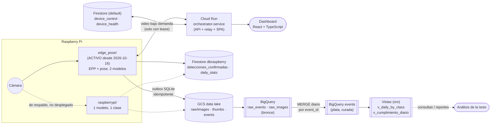
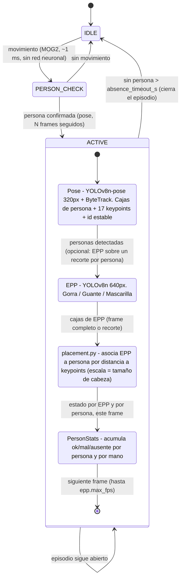
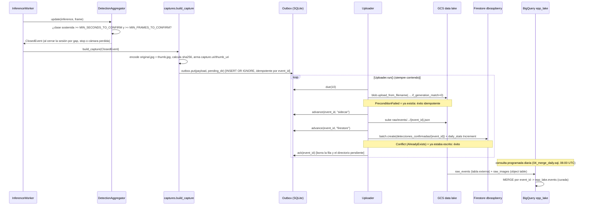

# Arquitectura

**Para quién es:** quien necesite entender cómo está armado el sistema para modificarlo, depurarlo
o evaluarlo (otro desarrollador, un revisor de la tesis). **Última verificación:** 2026-10-16
(agrega `edge_pose/`, nodo activo en la Pi física desde esa fecha — ver sección 0 y 1.1).

Fuente de diseño: `docs/PLAN_REMEDIACION.md` secciones 1, 5, 6, 7 y 15 (para `raspberrypi/`) y
`docs/INTEGRACION_NODO_POSE.md` (para `edge_pose/`). Este documento describe el código tal como
quedó implementado en `backend/epp_api/`, `raspberrypi/epp_edge/` y `edge_pose/epp_edge/`; donde el
plan y el código difieren en un detalle menor, manda el código (se anota en el texto).

## 0. Panorama general (dos nodos de borde, una sola nube)



`edge_pose/` y `raspberrypi/` publican con el **mismo contrato** (outbox idempotente, `event_id`
UUIDv7, lago por partición Hive, batch atómico de Firestore) — ver sección 1.1 y
`docs/DATA_MODEL.md`. La diferencia es qué generan: `raspberrypi/` una detección por clase;
`edge_pose/` un **episodio** (presencia continua de una persona) con veredicto de cumplimiento,
representado como una pseudo-detección (`episodio_conforme`/`episodio_no_conforme`) para que el
resto del sistema (Firestore, BigQuery, el dashboard) no necesite distinguir cuál de los dos lo
generó.

## 1. Componentes

### 1.1 Borde, nodo ACTIVO — `edge_pose/epp_edge/` (dos modelos: EPP + pose)

Reemplaza en la Pi física a `raspberrypi/epp_edge/` desde el 2026-10-16 (ver 1.1-bis). Un solo
proceso (`python -m epp_edge.main`) con una máquina de estados de 3 niveles que escala el costo
de cómputo según haga falta — en reposo no corre ningún modelo:



Al cerrar el episodio (`_close_episode`), se calcula el veredicto final por persona
(`compliance_ratio`, mínimo de frames evaluables) y se arma el payload que sube `cloud_v2.py`.
Más detalle de las reglas de colocación (cómo se decide "casco bien puesto" vs "mal puesto" vs
"ausente") en `edge_pose/CAMBIOS_CESAR.md` y `docs/INTEGRACION_NODO_POSE.md`.

| Componente | Archivo | Rol |
|---|---|---|
| `Camera` | `capture.py` | Captura continua (picamera2/USB/archivo), siempre expone el último frame |
| `EPPStateMachine` | `state_machine.py` | La máquina de estados de arriba; wiring de `motion.py` + `detectors.py` + `placement.py` |
| `MotionDetector` | `motion.py` | MOG2 sobre 160px; único "sensor" activo en `IDLE` |
| `PoseDetector` / `EPPDetector` | `detectors.py` | Envoltorios de Ultralytics/NCNN para cada modelo |
| `placement` | `placement.py` | Asociación EPP↔persona y reglas geométricas de colocación |
| `cloud_v2` | `cloud_v2.py` | Mismo patrón que `raspberrypi/outbox.py`: outbox idempotente, `DeviceControl`, `HealthReporter`, `StreamWorker` |
| `LocalServer` | `local_server.py` | Vista MJPEG + estado en LAN, para depurar sin pasar por la nube |

### 1.1-bis Borde, nodo de respaldo (no desplegado) — `raspberrypi/epp_edge/`

Un solo proceso (`python -m epp_edge`, entrypoint `app.py`) con varios hilos que se comunican por
dos estructuras en memoria (`LatestSlot`, uno por tipo de dato) y una base SQLite local (el
outbox). Ningún hilo bloquea a otro: el productor siempre sobrescribe, el consumidor siempre lee
lo más reciente. Queda en el repo como respaldo/referencia; el dispositivo real (`raspberry-pi-01`)
corre `edge_pose/` desde el 2026-10-16 (ver `docs/HANDOFF_CLAUDE_CODE.md` §4/§7).

| Hilo / componente | Archivo | Rol | Slot que produce / consume |
|---|---|---|---|
| `CaptureThread` | `capture.py` | Lee la cámara (picamera2 / USB / archivo) con reintento y backoff si falla | produce en `frames: LatestSlot[Frame]` |
| `InferenceWorker` | `inference.py` | Corre YOLO (NCNN, `imgsz=416`) a lo sumo a `INFERENCE_FPS`; calcula `model_version` (SHA-256 del modelo) | consume `frames`, produce en `results: LatestSlot[Inference]`, llama a `Pipeline._on_result` |
| `DetectionAggregator` | `aggregator.py` | Convierte detecciones frame a frame en sesiones por clase (anti-ruido); una sesión por **clase**, no por persona | no es un hilo: lo invoca `_on_result` bajo `_agg_lock` |
| `StreamWorker` | `streamer.py` | Sube video por WebSocket a Cloud Run, **solo** si `control.should_stream()` es verdadero | consume `frames` y `results` (para dibujar las cajas de la última inferencia sobre el frame más fresco) |
| `Uploader` | `outbox.py` | Hilo que corre siempre (también con la detección pausada); vacía el outbox hacia GCS y Firestore | consume la tabla `outbox` de SQLite |
| `DeviceControl` | `control.py` | Listener (`on_snapshot`) de `device_control`; decide `should_run()` / `should_stream()`; conserva el último estado si Firestore falla | hilo de respaldo (`control-safety`) que relee cada `CONTROL_SAFETY_POLL_SECONDS` |
| `HealthReporter` | `control.py` | Escribe `device_health` cada `HEARTBEAT_SECONDS` y en cada transición (debounce de 2 s) | hilo propio |

`Pipeline` (en `app.py`) agrupa captura + inferencia + streaming + agregador y se crea/destruye
según `desired_state`; al detenerse cierra las sesiones abiertas con `flush_all()` para no perderlas
(hallazgo D1 del plan). El bucle principal de `main()` también llama `sd_notify("WATCHDOG=1")` solo
si `pipeline.healthy()`, de modo que systemd reinicia el proceso si la inferencia se cuelga.

### 1.2 Nube — `backend/epp_api/` (Cloud Run, servicio `orchestrator-service`)

Un solo servicio FastAPI con `--workers 1` y `max-instances=1` (el estado del relay de video vive
en memoria de proceso: dos instancias significarían "pantalla negra" para quien mire el video si
cae en la otra). Módulos:

| Módulo | Rol |
|---|---|
| `relay.py` | `/ws/video/{device_id}`: recibe los frames de la Pi y los publica en un `DeviceChannel` en memoria (un `asyncio.Condition` por dispositivo) |
| `live.py` | `/api/devices/{id}/live`: WebSocket al navegador; reenvía lo que publica `relay.py`, acota a `LIVE_MAX_FPS` y gestiona el lease de streaming |
| `lease.py` | `StreamingLease`: cuenta espectadores por dispositivo; con ≥1 escribe `device_control.stream_requested=True` y renueva el lease cada `LEASE_SECONDS/3`; con 0 lo apaga |
| `auth.py` | ID token de Google → cookie de sesión firmada (`itsdangerous`); CSRF; roles; autenticación de WebSockets |
| `repo.py` | Acceso a Firestore con caché incremental compartida entre usuarios (sin listeners: la instancia no tiene CPU entre requests con `--cpu-throttling`) |
| `lake.py` | URLs firmadas v4 de GCS sin archivo de key (`signBlob` de la propia SA) |
| `audit.py` | Escritura asíncrona de `audit_log` (no bloquea la request que la dispara) |
| `routers/{auth,devices,events,admin}.py` | Endpoints REST (contrato en `docs/API.md`) |
| `main.py` | Cablea los routers, monta la SPA estática y expone `/healthz` |

### 1.3 Navegador — `frontend/src/`

React 19 + TypeScript + Vite. Habla con el backend solo por `api/client.ts` (REST) y `api/live.ts`
(WebSocket de video). `hooks/ActivityProvider.tsx` apaga los `refetchInterval` de TanStack Query y
cierra el WebSocket de video cuando el usuario está inactivo (`useIdle`, 15 min) o la pestaña está
oculta — es lo que mantiene el costo de Cloud Run bajo con el dashboard abierto.

## 2. Secuencia: abrir "En vivo"

```mermaid
sequenceDiagram
    participant U as Usuario (navegador)
    participant FE as SPA (LivePlayer)
    participant CR as Cloud Run (live.py + lease.py)
    participant FS as Firestore (default)/device_control
    participant PI as Pi (DeviceControl + StreamWorker)
    participant RL as Cloud Run (relay.py)

    U->>FE: abre /live
    FE->>CR: WS /api/devices/{id}/live (cookie epp_session)
    CR->>CR: authenticate_ws (cookie + Origin == PUBLIC_BASE_URL)
    CR->>FS: stream_requested=true, lease_renewed_at=now (StreamingLease.acquire)
    FS-->>PI: on_snapshot notifica el cambio (listener en vivo)
    PI->>PI: control.should_stream() = true
    PI->>RL: WS /ws/video/{id} (Authorization: Bearer DEVICE_TOKEN)
    loop cada 1/STREAM_FPS
        PI->>RL: frame (8 bytes captured_at + JPEG)
        RL->>CR: DeviceChannel.publish() -> notify_all()
        CR->>FE: frame binario (acotado a LIVE_MAX_FPS)
        FE->>FE: createImageBitmap + canvas; actualiza fps/latencia "≈"
    end
    loop cada LEASE_SECONDS/3
        CR->>FS: renew_lease() -> lease_renewed_at=now
    end
    U->>FE: cierra la pestaña o entra en inactividad
    FE->>CR: cierra el WebSocket
    CR->>FS: stream_requested=false (StreamingLease.release, último espectador)
    PI->>PI: el lease vence (<= LEASE_SECONDS) -> should_stream() = false
    PI->>RL: cierra el WebSocket de uplink
```

Puntos de diseño: la Pi nunca abre el stream sola (salvo `AUTO_STREAM_ON_DETECTION=true`, apagado
por defecto); el relay nunca sondea, el `asyncio.Condition` despierta al espectador en cuanto llega
un frame nuevo; si el espectador es lento, `next_frame()` siempre entrega el **más reciente** (se
saltan frames, nunca se acumulan).

## 3. Secuencia: evento confirmado (captura → lake → Firestore → BigQuery)



El orden imágenes → sidecar → Firestore garantiza que si el documento existe en Firestore, su
captura **ya** está en el lake. Si falta el frame de mejor confianza o el disco se queda sin
espacio, el evento **nunca se descarta**: se registra con `capture.status` = `missing` o
`dropped_disk_full` (ver `docs/DATA_MODEL.md`).

`edge_pose/` sigue el mismo diagrama con dos cambios: `AGG` es la máquina de estados de la sección
1.1 (cierra el episodio al salir de `ACTIVE`, no una sesión por clase) y `CAP`/`OUT`/`UP` son las
mismas piezas pero en `cloud_v2.py` en vez de `captures.py`/`outbox.py` — mismo outbox SQLite
idempotente, mismo orden imágenes → sidecar → Firestore, mismo `if_generation_match=0`. Lo único
que cambia es el contenido del payload (episodio en vez de sesión por clase — sección 1-bis de
`docs/DATA_MODEL.md`).

`edge_pose/` tiene además un hilo `CaptureWorker` (`training_capture.py`), hermano de
`StreamWorker` pero para fotos en vez de video: mientras `control.should_capture()` sea verdadero
(toggle persistente en `device_control`, sin lease — a diferencia de `should_stream()`), sube
fotos **crudas** de la cámara (no las anotadas de `frames`/`FrameBuffer`) a
`raw/training_captures/...` con el mismo `if_generation_match=0` del `Uploader`, y lleva el
progreso en Firestore (`training_sessions/{session_id}`). No usa el outbox SQLite de episodios:
perder una foto suelta de una sesión de cientos no amerita esa maquinaria, solo un reintento corto.
Una salvaguarda local (`max_duration_s`, 1 hora por defecto) cierra la sesión sola si nadie la
detiene desde el panel. Detalle completo y la justificación de cada decisión en
`docs/DATA_LAKE.md` y `docs/DATA_MODEL.md`.

## 4. Modos de falla

| Falla | Comportamiento |
|---|---|
| Sin red (Pi) | `Uploader` sigue encolando y reintentando con backoff exponencial (`min(300, 2**attempts)` segundos); `device_health.outbox_pending` crece; nada se pierde mientras haya espacio en disco |
| Disco lleno (`OUTBOX_MAX_BYTES`) | Se borran las **imágenes pendientes** más viejas (`enforce_cap`), nunca los eventos; quedan con `capture.status="dropped_disk_full"` |
| Sin cámara | `CaptureThread` reintenta con backoff (1, 2, 4… 60 s); si no hay cámara y `ALLOW_TEST_VIDEO` no está activo, **nunca** cae al video de prueba: `camera_ok=false` y cero eventos (corrige el hallazgo D2 del plan) |
| Cámara se pierde con una sesión abierta | `Pipeline.tick()` cuenta cuánto lleva caída; al superar `SESSION_GAP_SECONDS` cierra las sesiones confirmadas con `closed_reason="camera_lost"` |
| Firestore no responde (control) | `DeviceControl` conserva el último `desired_state`/lease conocido; solo usa el valor por defecto si nunca hubo una lectura exitosa (corrige D6) |
| Apagado / reinicio del servicio (`SIGTERM`) | `Pipeline.stop("shutdown")` cierra las sesiones abiertas con `flush_all()`, el `Uploader.drain()` tiene hasta 10 s para subir lo pendiente antes de que el proceso termine |
| Instancia de Cloud Run cae con el relay activo | El consumidor (`live.py`) recibe `frame=None` en `next_frame` y manda `{"type":"status","state":"ended"}`; la SPA no muestra un frame viejo como "en vivo" |
| Cliente de "En vivo" se desconecta abruptamente | `StreamingLease.release` es idempotente; `asyncio.shield` en `live.py` garantiza que el lease se libera aunque el handler se cancele |
| Espectador lento | `relay.next_frame` y `live._pump` siempre entregan el frame más reciente: un cliente lento se salta frames, nunca acumula atraso |

## 5. Presupuesto de latencia

Estimaciones comparadas con el flujo anterior (Pub/Sub + polling + Flet); **a validar con
mediciones reales en la Fase 10** (`docs/PLAN_REMEDIACION.md` sección 16).

| Tramo | Antes | Después (estimado, pendiente de medir) |
|---|---|---|
| Arranque del stream | 0-5 s (polling de la Pi) + 0-2 s (dashboard) + cold start | < 1 s (listener de Firestore) + cold start (1-3 s) |
| Captura → frame disponible | Crecía con el buffer de V4L2 | ≤ 1 frame (`buffer=1`, `LatestSlot`) |
| Frame → envío | Captura + inferencia + dibujo + JPEG en serie | Dibujo + JPEG (~10-20 ms a 640 px); la inferencia corre en paralelo en otro hilo |
| Relay (Cloud Run) | 0-30 ms (polling cada 30 ms) | ~0 ms (`asyncio.Condition.notify_all`) |
| Saltos de red del video | Pi → Cloud Run → backend del dashboard → navegador | Pi → Cloud Run → navegador (un salto menos) |
| Entrega al navegador | Polling a 8 fps + base64 por el WebSocket de Flet + re-render de Flutter | WebSocket binario, reenvío inmediato (tope `LIVE_MAX_FPS`), `createImageBitmap` + `<canvas>` |
| Primera carga del dashboard | Runtime de Flutter/CanvasKit (varios MB) | SPA < 300 KB gzip; después solo `index.html` y JSON de la API (assets con hash cacheados un año) |

Región: se mantiene `us-central1`. Moverla a Sudamérica bajaría el RTT desde Perú pero encarece
cómputo y egress; solo se reconsideraría si una medición real muestra que la red es el cuello de
botella (no se ha hecho esa medición).
